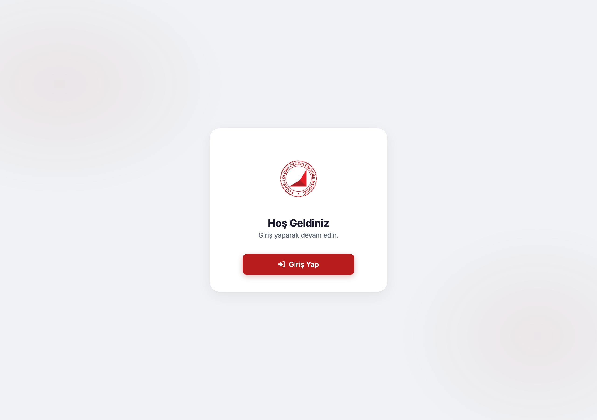
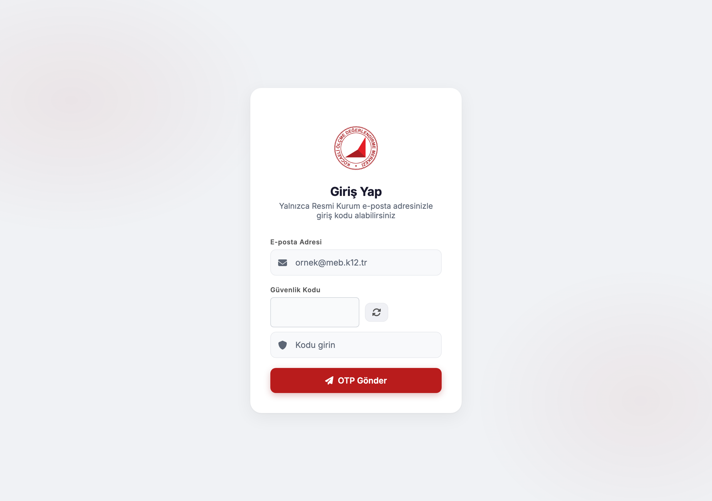

# KODM Panel — OTP login, documents, surveys and announcements

> A self-hosted school operations panel: passwordless email OTP login, announcements, data-collection surveys, file distribution, document requests and activity logs.

[](https://nodejs.org/)
[](https://expressjs.com/)
[](https://www.docker.com/)
[](LICENSE)

<p align="center">
  <a href="https://www.buymeacoffee.com/cmtrkr"></a>
</p>

KODM Panel is the application behind this repository's original name, `smtp-deneme`. It started as an SMTP/OTP experiment and grew into a practical admin panel for a Turkish school district. Users sign in with a one-time code sent to an approved institutional email address; there are no passwords to store. Administrators manage users, publish announcements and events, run surveys, distribute documents, collect file requests, track complaints and export reports.

The stack is deliberately small: Express, JWT, Nodemailer, Multer and JSON files. A Docker image and compose file are included.

## 📸 Screenshots

| Welcome | OTP login |
| :---: | :---: |
|  |  |

Both images are real captures of the running UI.

## ✨ Modules

- 🔐 **Passwordless login** — email + math captcha + OTP; JWT sessions.
- 👥 **Users and roles** — admin, high-school, middle-school and other roles, with cross-role access.
- 📣 **Announcements** — publish, edit, delete and track reads.
- 🗓️ **Events** — calendar-style event management.
- 📊 **Surveys (Veri Toplama)** — build questions, collect responses, view district statistics and export to Excel.
- 📁 **File distribution** — ZIP uploads, start/end dates, per-user download status.
- 📨 **Document requests (Belge İstekleri)** — request documents from schools, collect ZIP submissions, bulk download.
- 📝 **Requests / objections** — ticket flow with attachments and status updates.
- 🧾 **Reports** — activity logs, survey exports, delivery labels and print previews.
- ⚙️ **Settings** — maintenance mode and full backup/restore.
- 🌗 **Light/dark theme** — stored in `localStorage`, respects system preference.

## 🏗️ Architecture

```text
Browser (vanilla HTML/CSS/JS)
   │  JWT bearer token
   ▼
Express server (server.js)
   ├── Nodemailer ── SMTP ── OTP email
   ├── JSON data files (DATA_DIR)
   └── uploads/ (documents, attachments)
```

The frontend is served from `public/`: `index.html`, `login.html`, `dashboard.html`, `style.css` and `assets/`.

## 🚀 Setup

### Requirements

- Node.js 20+
- An SMTP account (Gmail app password, institutional relay, etc.)
- Docker (optional)

### Environment

Create `.env` in the project root:

```dotenv
PORT=4004
JWT_SECRET=replace-with-a-long-random-string
ADMIN_EMAIL=admin@example.com

SMTP_HOST=smtp.example.com
SMTP_PORT=587
SMTP_USER=no-reply@example.com
SMTP_PASS=your-smtp-password

PUBLIC_BASE_URL=http://localhost:4004
DATA_DIR=./data
```

Never commit `.env`. If an SMTP credential leaks, revoke it at the provider.

### Run locally

```bash
npm install
npm start        # node server.js
# or
npm run dev      # node --watch server.js
```

Open `http://localhost:4004`.

### Docker

```bash
docker compose up -d --build
```

The compose file mounts a named volume at `/app/data` so JSON files and uploads survive rebuilds. Set the same environment variables in the compose file or a `.env` file.

## 📁 Data layout

```text
data/
├── users.json
├── announcements.json
├── surveys.json
├── responses.json
├── files.json
├── file-requests.json
├── requests.json
├── logs.json
└── settings.json

uploads/
├── files/
├── file-requests/<submissionId>/
└── requests/
```

All JSON writes use an atomic temporary-file + rename pattern. Backups exclude `.env` by design.

## 🔌 API overview

| Area | Endpoints |
| --- | --- |
| Auth | `GET /api/captcha`, `POST /api/send-otp`, `POST /api/verify-otp`, `GET /api/me` |
| Users | `/api/users`, `/api/users/:email`, `/api/users/import` |
| Announcements | `/api/announcements`, `/api/announcements/:id/read` |
| Events | `/api/events` |
| Surveys | `/api/surveys`, `/api/surveys/:id/responses`, `/api/surveys/:id/district-stats` |
| Files | `/api/files`, `/api/files/:id/download`, `/api/files/:id/status` |
| Document requests | `/api/file-requests`, `/api/file-requests/:id/download-all` |
| Requests | `/api/requests` |
| Logs | `/api/logs`, `/api/logs/export` |
| Backup | `POST /api/backup`, `POST /api/backup/restore` |
| Status | `GET /api/status` |

Most routes require `Authorization: Bearer <token>`; admin routes additionally check the role.

## 🔐 Security notes

- Set a strong `JWT_SECRET` and a real `ADMIN_EMAIL`.
- Serve over HTTPS behind a reverse proxy; set `PUBLIC_BASE_URL` accordingly.
- Keep the OTP and global rate limits enabled.
- Uploads are restricted to ZIP files, 10 MB per file (attachments up to 10 MB).
- Backups contain personal data — store them encrypted and delete old copies.
- The panel is intended for a trusted institutional network. Review access before exposing it publicly.
- This is an independent project, not an official Ministry of National Education service.

## 🧪 Tests

```bash
npm test
```

The test folder uses Node's built-in test runner.

## ❤️ Support

If this panel saves your institution time, you can buy me a coffee:

<p align="center">
  <a href="https://www.buymeacoffee.com/cmtrkr"></a>
</p>

## 📄 License

[MIT](LICENSE) © 2026 Cem Türker.
